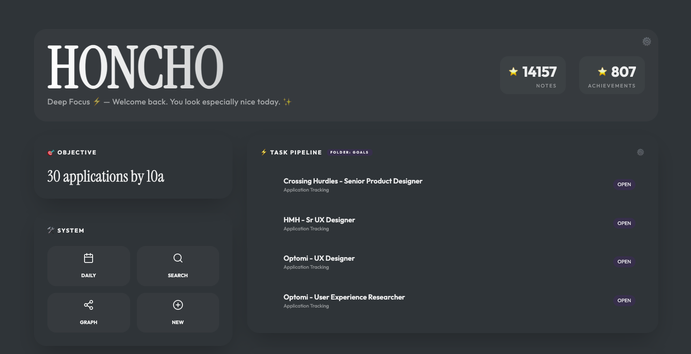
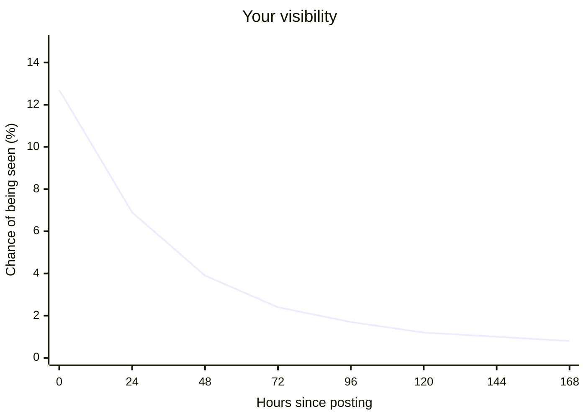
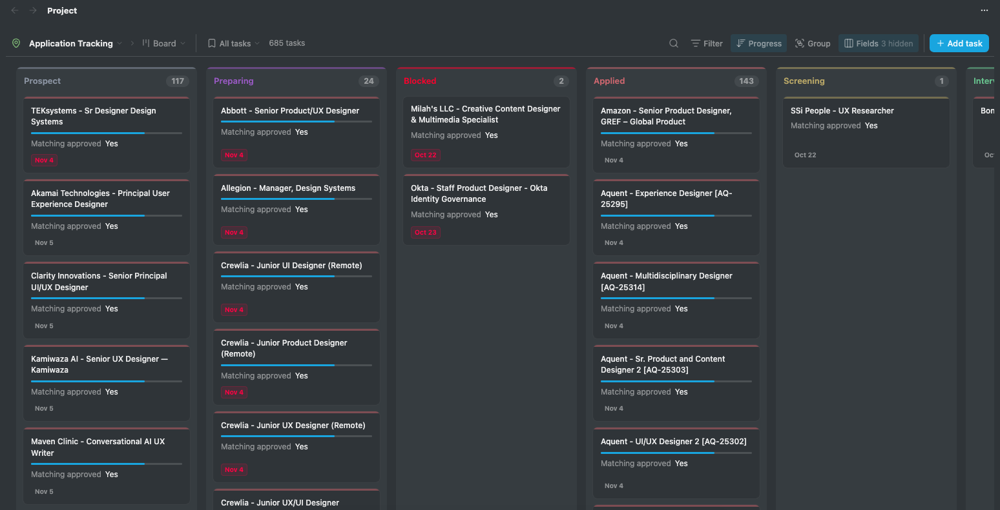
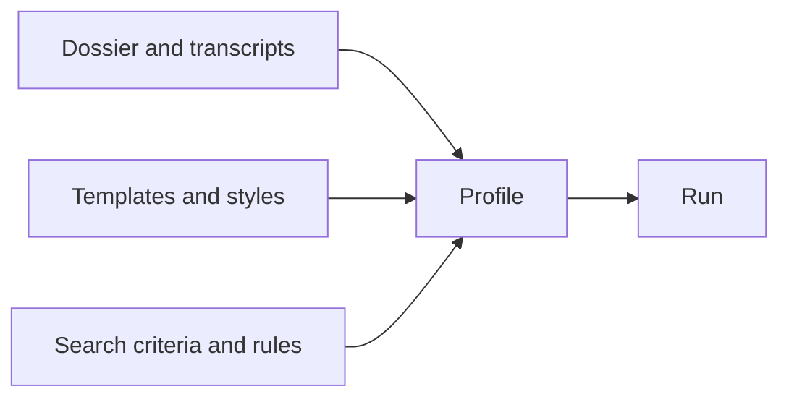
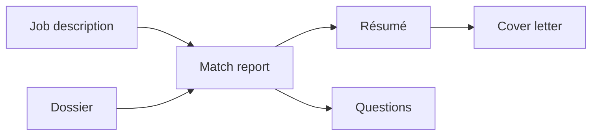
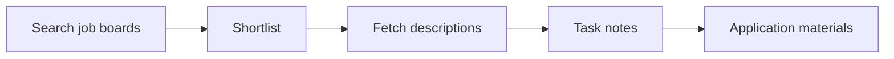

# Honcho

Honcho uses Claude Code and Python to read job postings and tailor application materials to each one, so that employers see the clearest, richest picture of you. It knows the parts of your work experience that will count the most for a given role and builds a résumé and cover letter around them. It even rolls out a list of answers to the open-ended questions you are likely to encounter.



**Get started**

1. `git clone https://github.com/datainkio/honcho && cd honcho && cp .env.example .env`
2. Add résumés or a LinkedIn export to `applicant/dossiers/`, then run `/job-setup` in Claude Code.
3. Run `/job-retrieval`, then `/resume-tailoring <job_id>` for each posting you pick.

## Be seen by real, live hoomans.

> "Are you the Gatekeeper?"\
> — Vinz Clortho, _Ghostbusters_ (1984)

Before a person reads your résumé, software does. Honcho formats every résumé so applicant tracking systems read it cleanly and pass it on. It writes using the posting's own vocabulary, making you easier for recruiters and hiring managers to find.



Recruiters sort applicants newest first and stop reading once they have a shortlist, so an application's chance of being seen halves within a day and is mostly gone by day four. Compiled from [Jobloo](https://jobloo.co/blog/best-day-time-to-apply-jobs-data/), [TalentWorks](https://vinayakapoor.com/applying-early-beats-applying-often/), [GoApply](https://jobstrack.io/blog/first-mover-advantage-applying-early-tech-jobs), [Gecko Hospitality](https://www.geckohospitality.com/this-is-the-best-time-of-the-day-to-apply-for-jobs/) and five other job-search articles.

## Create application materials unique to you and written for decision makers.

> "Are you the Keymaster?"\
> — Zuul, _Ghostbusters_ (1984)

Hand Honcho your résumés, LinkedIn export or notes, and it builds a dossier: one complete record of your work. As it tailors each application, it notes what a posting asks for that your dossier doesn't show yet, so you can round it out after every run. You set the voice by editing the résumé and cover-letter templates, and profiles let you swap dossiers, templates and search criteria between runs.

## Track your applications across their entire lifecycle.

Every posting becomes a note that follows it from Prospect to Applied, Screening, Interviewing and Offer. Each note links the exact résumé and cover letter you sent, so you always know which version of you an employer saw. The notes are plain Markdown, built for Obsidian's dotpm plugin but readable anywhere.



## What's here

### Source Material

Folders for user-supplied material, pipeline output, configuration profiles, and reference materials.

### Obsidian

At the root of the repo is an Obsidian vault. Obsidian is not required; its primary role is to provide data views and ease project management. The community plugin dotpm comes pre-installed to support the application lifecycle.

### Applicant

The applicant folder holds everything you supply. Each subfolder can hold several versions, and a profile picks one of each for a run:



### Applications

The applications folder is where Honcho renders content tailored for particular job descriptions. It supplies what may be the most important bits: the docx/pdf files uploaded as part of the online application.

Each posting gets one folder, built from its task note and your dossier:



### Pipeline

The pipeline folder holds the Python scripts that do the mechanical work and the Claude Code skills that make the judgment calls:



### Profiles

A profile is a Markdown file whose frontmatter names one file from each applicant subfolder. Set `profile:` in `honcho.yaml` to choose one, or override it for a single run with `HONCHO_PROFILE`:

```yaml
dossier: professional-profile # applicant/dossiers/professional-profile.md
resume template: default # applicant/resumes/DEFAULT.md
cover letter template: default
criteria: default
rules: default
```

## Contributing

Issues and pull requests are welcome. Use commit prefixes (`feat:`, `fix:`, `docs:`). Be a pal and run `python3 pipeline/scripts/setup_check.py` before you open a pull request.

## Acknowledgements

Honcho is built on the work of others:

- [Claude Code](https://claude.com/claude-code) by Anthropic runs the judgment steps.
- [linkedin-mcp-server](https://github.com/stickerdaniel/linkedin-mcp-server) by stickerdaniel drives LinkedIn search and retrieval.
- [dotpm](https://dotpm.pm) and [Dataview](https://github.com/blacksmithgu/obsidian-dataview) power application tracking in [Obsidian](https://obsidian.md).
- [PyYAML](https://pyyaml.org), [python-docx](https://python-docx.readthedocs.io) and [ReportLab](https://www.reportlab.com) read the configuration and render the résumés and cover letters.
- Postings come from [LinkedIn](https://www.linkedin.com), [Jobgether](https://jobgether.com), [Indeed](https://www.indeed.com), [UI/UX Jobs Board](https://uiuxjobsboard.com), [Fantastic.jobs](https://fantastic.jobs) and [TheirStack](https://theirstack.com).
- The visibility chart combines figures from [Jobloo](https://jobloo.co/blog/best-day-time-to-apply-jobs-data/), [Vinayak Kapoor](https://vinayakapoor.com/applying-early-beats-applying-often/), [jobstrack.io](https://jobstrack.io/blog/first-mover-advantage-applying-early-tech-jobs), [Gecko Hospitality](https://www.geckohospitality.com/this-is-the-best-time-of-the-day-to-apply-for-jobs/), [DEV Community](https://dev.to/fzsheik/why-applying-in-the-first-hour-gets-more-replies-40el), [MyPivot](https://mypivot.substack.com/p/90-of-interviews-go-to-people-who), [TurboResume](https://turboresume.ai/en/blog/how-many-applications-to-get-hired/), [InterviewPal](https://www.interviewpal.com/blog/why-early-job-applications-get-more-attention-and-what-that-actually-means-for-you) and [Lynceus](https://trylynceus.com/blog/how-soon-to-apply-after-a-job-is-posted).

## License

Honcho is released under the [MIT License](LICENSE). Copyright (c) 2026 Russell S. Lebo.
