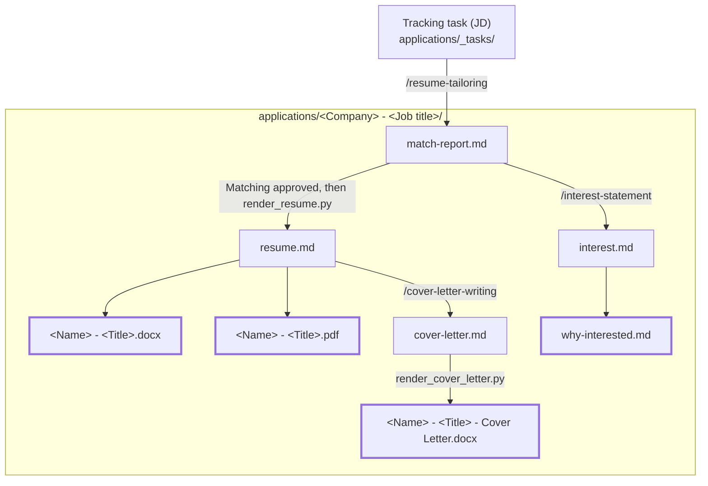

# Pipeline Output

This is where the pipeline writes the application packages.

## Versioning & Privacy

Given that the contents of this folder are specific to the operator, only the README and any sibling files get committed. Folders - assumed to contain pipeline output - remain local-only.

## The Application Package

Each posting gets one folder, named after its tracking task: `<Company> - <Job title>`. When two postings share a company and title, the folder name ends with ` (<job_id>)`. Each file is written by the skill or script on the arrow that points to it. Highlighted files are the ones you submit: upload the `.docx`/`.pdf` files and paste the text of `why-interested.md`.

