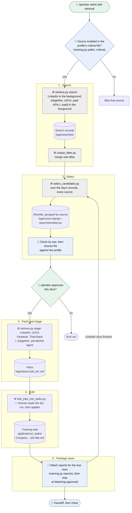
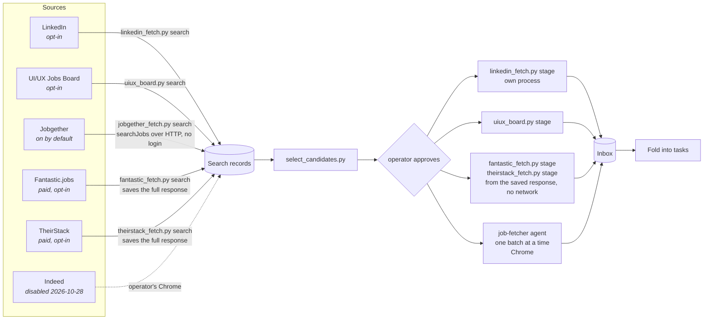
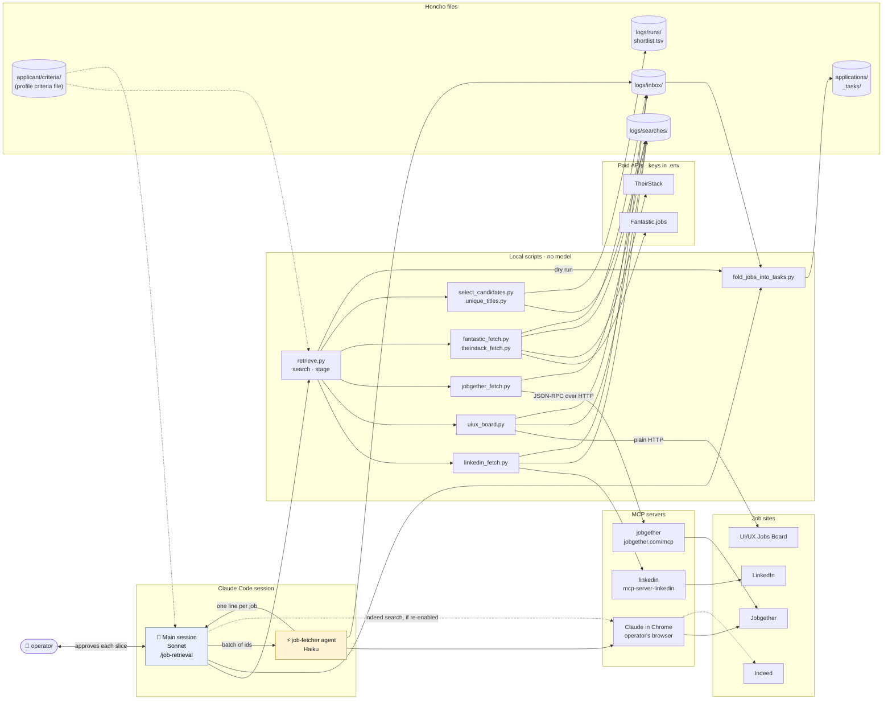
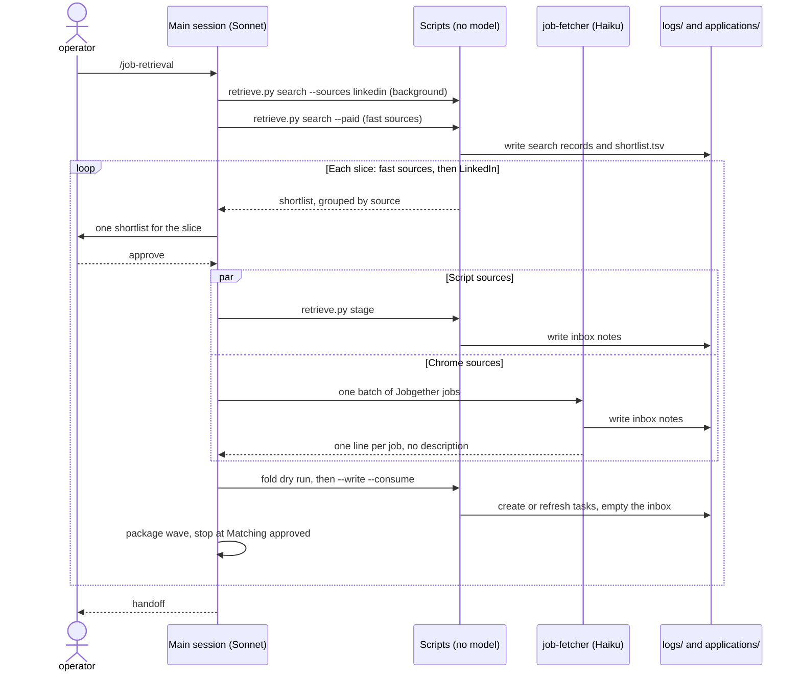
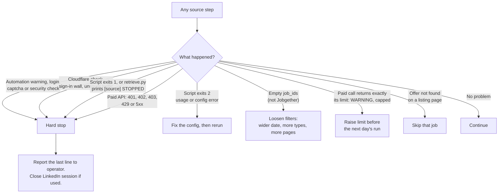

# job-retrieval

`/job-retrieval` runs one manual retrieval session: it searches the enabled job sources, picks the likely fits, stages their descriptions, folds them into tracking tasks, and starts the package wave. The operator approves each slice before anything is fetched. Nothing here is scheduled or unattended. The operational authority is [SKILL.md](SKILL.md). These diagrams explain it.

## Who is responsible for what

One of the key values of this project is optimal token efficiency. Towards that end, responsibilities are distributed across models depending upon the particular needs of the task. Retrieval is fairly low cost given that much of it is handled by Python scripts. LLMs come into play when interpreting results, authoring files, and working with MCP servers.

| Tag | Who                   | Used for                                                                                     |
| --- | --------------------- | -------------------------------------------------------------------------------------------- |
| 🧑  | Operator (hooman)     | Starting the run, approving each slice                                                       |
| 🧠  | Sonnet (main session) | Source checks, choosing fits, reading dry runs, the package wave, the handoff                |
| ⚡  | Haiku (`job-fetcher`) | Opening Jobgether listings (and Indeed, if re-enabled) in Chrome and staging the description |
| ⚙️  | Python scripts        | Searching, de-duplicating, staging LinkedIn, UI/UX and the paid APIs, folding. No model      |

The runbook reserves the more capable models for résumé bases, cover letters, specs and decisions.

## The flow

Five steps, one confirmation per slice. The confirmation sits between Select and Fetch, because a full description costs about 3.5k tokens. A streamed run (D26, D30) has two slices: the fast sources first, then LinkedIn when its paced search finishes. Each slice goes through Select, approval, staging, the fold and its own package wave. That is at most three confirmations a run, the third only if Indeed is turned back on.

Each step is tagged with what does the work. Scripts run no model, so they cost no tokens beyond the one-line results the main session reads. Sonnet runs the session and makes the judgment calls. Haiku only reads Chrome pages, so full descriptions stay out of Sonnet's context.

## Where each source goes

The sources differ in how they search and how they fetch. Descriptions never enter the main session. Scripts write them straight to the inbox, and the `job-fetcher` agent (Haiku) reads the Chrome sources. `retrieve.py` runs every script source's search, then every stage, as one command each.

| Source            | Search                       | Fetch                           | Pace                                             |
| ----------------- | ---------------------------- | ------------------------------- | ------------------------------------------------ |
| LinkedIn          | script, logged-in browser    | script, logged-in browser       | enforced delay and fetch cap                     |
| UI/UX Jobs Board  | script, plain HTTP           | script                          | 5 seconds between requests                       |
| Jobgether         | script, search API over HTTP | job-fetcher in Chrome           | 2 seconds between requests                       |
| Fantastic.jobs    | script, paid API             | script, from the saved response | one call per search a day; `limit` caps the cost |
| TheirStack        | script, paid API             | script, from the saved response | one call per search a day; `limit` caps the cost |
| Indeed (disabled) | Chrome                       | job-fetcher in Chrome           | 8 seconds between page loads                     |

## The services

What the run talks to, and which model sits where. Solid lines are calls the run makes. The scripts own all search traffic and every LinkedIn, UI/UX and paid-API read, so the main session never touches those sites directly. Only listing pages that block scripts (Jobgether, and Indeed while enabled) go through Claude in Chrome.

Two design choices show up here. Staged descriptions go from script or agent straight to the inbox, so the 3.5k-token bodies never pass through Sonnet. And the job-fetcher shares operator's Chrome, so batches run one at a time. The LinkedIn script drives its own browser profile (`~/.linkedin-mcp/profile/`), so it runs beside the Chrome batches.

## Who does what

## The models

The skill moves one posting through five shapes. Each is a file, and each is derived from the one before it. The task is the only permanent copy of the job description (D5).

```mermaid
erDiagram
  SEARCH_CRITERIA ||--o{ SEARCH_RECORD : "drives"
  SEARCH_RECORD ||--|{ JOB_ID_ROW : "lists"
  JOB_ID_ROW ||--o| SHORTLIST_ROW : "kept by Select"
  SHORTLIST_ROW ||--o| INBOX_NOTE : "approved and staged"
  INBOX_NOTE ||--|| TASK : "folded into, then deleted"
  TASK ||--o| MATCH_REPORT : "downstream"
  MATCH_REPORT ||--o| APPLICATION_PACKAGE : "downstream"

  SEARCH_CRITERIA {
    file path "applicant/criteria/ (the profile's criteria)"
    config fit "check, targets, location, skip"
    config selection "batch_size, exclude_title_terms (every source)"
    config sources "per source: enabled, pacing, defaults, searches"
  }
  SEARCH_RECORD {
    file path "logs/searches/DATE--name.md"
    file raw_response "paid sources: DATE--name.json beside it"
    text search_name
    datetime run_at
    object criteria
    number result_count
    boolean capped "paid sources: the call returned exactly its limit"
  }
  JOB_ID_ROW {
    text job_id
    text title
    text company
    date posted
    text fetched
  }
  SHORTLIST_ROW {
    file path "logs/runs/STAMP-search/shortlist.tsv"
    text source
    text search
    text job_id
    text company
    text title
    text location
  }
  INBOX_NOTE {
    file path "logs/inbox/job_id.md"
    text type "source-job, e.g. jobgether-job"
    text job_id PK
    text url
    text title
    text company
    text location
    text work_type
    datetime retrieved_at
    text source_search
    boolean over100 "LinkedIn only"
    body description "verbatim, transient"
  }
  TASK {
    file path "applications/_tasks/"
    text job_id PK
    text title "Company - Job title"
    select work_type
    select status "hiring stage"
    select priority "critical, or medium when over100 (D27)"
    number fit_score
    body description "verbatim, only copy"
  }
  MATCH_REPORT {
    file path "applications/TASK NAME/match-report.md"
    note scope "next skill: resume-tailoring"
  }
  APPLICATION_PACKAGE {
    file path "applications/TASK NAME/"
    note scope "résumé, cover letter, interest statement"
  }
```

Field definitions: the [job posting content model](../../../reference/content%20models/Job%20Posting.md). The inbox and search-record schemas are still in the old automation repo's `data/README.md` (not yet migrated).

## What can stop a run

A hard stop ends the whole run, Chrome work included. Don't retry.

<!-- readme-index:start -->

## Index

- [references/](references/README.md)
- [SKILL.md](SKILL.md)
<!-- readme-index:end -->
