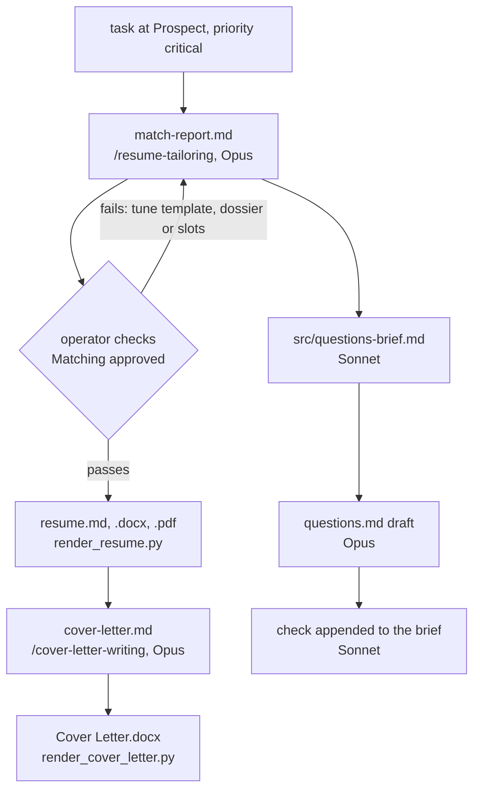
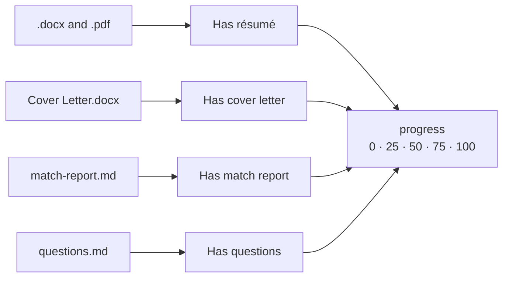

# Application

One folder per posting holds its whole package ([D11](../../context/decisions.md)):

```
applications/<task name>/
├── match-report.md                          Match Report      reviewed before render
├── resume.md                                Resume            the filled template
├── <Name> - <Title>.docx                    Resume            submitted
├── <Name> - <Title>.pdf                     Resume            submitted
├── cover-letter.md                          Cover Letter      letter source
├── <Name> - <Title> - Cover Letter.docx     Cover Letter      submitted
├── questions.md                             Questions         pasted into forms
└── src/questions-brief.md                   Questions         brief and check
```

## Naming

| Part          | Rule                                                                                                          | Code                       |
| ------------- | ------------------------------------------------------------------------------------------------------------- | -------------------------- |
| `<task name>` | `<Company> - <Job title>` from the task's `title` (not its file name), keeping a collision ` (<job_id>)` at the end | `naming.task_folder()`     |
| `<Name>`      | `name:` in the dossier's frontmatter                                                                          | `naming.candidate_name()`  |
| `<Title>`     | the job title without the company; a trailing `[requisition code]` dropped; `/ \ : * ? " < > \| # ^ [ ]` become `-` | `naming.job_title()`, `naming.safe()` |

The recruiter sees the file names, so they carry only the candidate and the role. The folder name never reaches the employer.

## How a package is made



| File                       | Needs first                                         | Gate                                                    |
| -------------------------- | --------------------------------------------------- | ------------------------------------------------------- |
| `match-report.md`          | the task                                            | not frozen; batches take only `naming.py reports` due rows |
| `resume.md`, `.docx`, `.pdf` | the match report                                  | _Matching approved_ checked; not frozen; no unfilled slot or forbidden character |
| `cover-letter.md`, `.docx` | `resume.md`                                         | `honesty_review: passed`; not frozen                    |
| `questions.md`             | the match report                                    | status Prospect                                         |

Briefs for the answers start as soon as a match report lands, while the operator reviews it. Answers are written independently of the cover letter.

## Progress

`task_links.py` reads the folder and sets four checkboxes on the task, then `progress` as the share checked ([D38](../../context/decisions.md)). The résumé `.docx` and `.pdf` together count as one.



The renderers and the fold call it themselves; the skills that write a match report or answers run `task_links.py --write <job_id>…` after writing.

## Frozen packages

Once a task is at Applied, Screening, or any status with dotpm's "done" toggle, nothing in its folder is edited, re-derived or re-rendered, by script or by hand ([D13](../../context/decisions.md)). A frozen package records what was sent, even when its template or dossier has since changed.

## Legacy files

Packages from before the current skills may also hold:

| File                       | What it was                                                                                     |
| -------------------------- | ----------------------------------------------------------------------------------------------- |
| `interest.md`              | the brief for an interest statement (`type: interest-brief`), with its `## Check`               |
| `why-interested.md`        | a 3-5 sentence answer to 'Why are you interested?' (`type: why-interested`). Superseded by [Questions](Questions.md) ([D19](../../context/decisions.md)); the links block still links it |
| `application-questions.md` | answers before `questions.md`; still counts for _Has questions_                                 |
| `* - Cover Letter.pdf`, `*.pages` | files the operator exported by hand                                                    |
