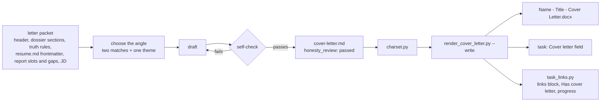
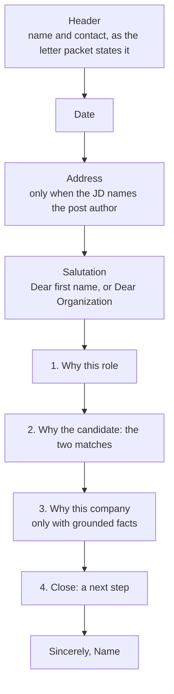

# Cover Letter

A one-page letter for one posting, written by [`/cover-letter-writing`](../../pipeline/skills/cover-letter-writing/SKILL.md) on Opus. Unlike the résumé, it is free prose, held to the dossier, the truth rules and the posting's résumé. The skill is the operational authority; this model is the shape it writes.

## Files

| File                                   | Role                                       | Edited by                   |
| -------------------------------------- | ------------------------------------------ | --------------------------- |
| `cover-letter.md`                      | the letter and its metadata                | the skill, in one `Write`   |
| `<Name> - <Title> - Cover Letter.docx` | the submission file                        | never by hand               |

Both sit in the posting's [Application](Application.md) folder. The ` - Cover Letter` suffix keeps the letter's file from clashing with the résumé's.

## cover-letter.md

### Frontmatter

| Key               | Value                                                                        |
| ----------------- | ---------------------------------------------------------------------------- |
| `type`            | `cover-letter`                                                               |
| `job_id`          | the posting's id                                                             |
| `target_title`    | the job title without the company; names the `.docx`                         |
| `company`         | the employer                                                                 |
| `resume`          | `resume.md`                                                                  |
| `generated_at`    | ISO timestamp                                                                |
| `profile_version` | the dossier's `updated:` date                                                |
| `angle`           | one line: the two matches and the theme                                      |
| `company_facts`   | list: each fact with its source, `(source: JD)` or `(source: company profile)` |
| `open_questions`  | list: anything personal or company-specific the candidate could add          |
| `honesty_review`  | `passed`, set only after the self-check                                      |

### Body

- **Length:** three or four paragraphs, about 250–350 words, one page.
- **Header, date line, salutation and sign-off** come from the letter template through the packet, the same in every letter. Never guess a name for the salutation.
- **Tone** follows the employer type: startup, enterprise, government, agency or non-profit (the skill's table).

## Render rules

`render_cover_letter.py` renders a batch in one call and refuses a posting when:

- it is frozen ([D13](../../context/decisions.md))
- `cover-letter.md` is missing, or its `type` or `job_id` don't match the posting
- `honesty_review` isn't `passed`
- the posting's `resume.md` doesn't exist
- the text holds `< > { } "` or curly quotes ([D9](../../context/decisions.md))

It sets the task's _Cover letter_ field to `[[applications/<task name>/<Name> - <Title> - Cover Letter.docx|Cover letter]]` and refreshes the links block.

## Rules

- **Facts:** every claim traces to the dossier. Numbers match the résumé and keep their honest framing. No program-scale number as a personal outcome.
- **No invented motivation, connection or company knowledge.** Company facts come from the JD or one confirmed read-only company lookup. Anything personal goes to `open_questions`, not the letter.
- **Gaps:** a term on the résumé's `gaps` list is never claimed. A central gap may get the nearest honest adjacent experience, in one plain clause.
- **No seniority claim** the résumé doesn't make. Same titles, dates and numbers as the résumé.
- **Stale letter:** when `resume.md` has a newer `generated_at` than the letter, re-check the letter's titles and numbers before use.
