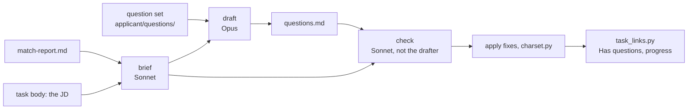
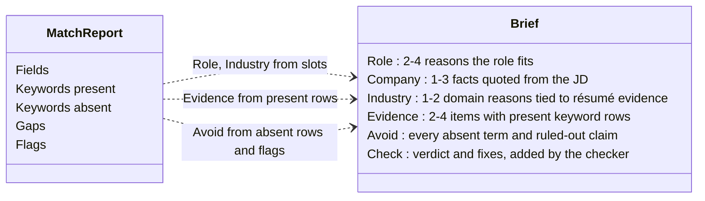

# Questions

Application forms often ask free-text questions. Two objects cover them: the **question set**, which the operator keeps, and a posting's **answers**, which [`/question-answers`](pipeline/skills/faqs/SKILL.md) writes. Answers are pasted, not rendered: there is no `.docx` or `.pdf`. The skill replaces the interest statement ([D19](../../context/decisions.md)).



## Question set

`applicant/questions/<value>.md`, named by the profile's `questions` key ([Profile](Profile.md)). The user supplies it. It is a **flat list**: one question per item (a line, a bullet or a heading), with no sections or nesting. Every posting's answers cover every item, in the list's order.

```markdown
# Commonly asked questions

- What is your interest in the company specifically?
- Describe a project you initiated yourself, from spotting the problem to shipping.
```

## Answers

### Gate

Answers are written only for a posting that has a match report and whose status is labelled Prospect. An existing `questions.md` is not overwritten unless the operator asks. The skill never changes a task's status.

### Brief

`applications/<task name>/src/questions-brief.md`, by Sonnet, from the JD and the match report only (never the dossier or the cover letter).

| Key            | Value                                                  |
| -------------- | ------------------------------------------------------ |
| `type`         | `questions-brief`                                      |
| `job_id`       | the posting's id, quoted                               |
| `company`      | the employer, or `Jobgether (employer unnamed)`        |
| `generated_at` | ISO date                                               |
| `brief_by`     | `sonnet`                                               |



Every bullet ends with its source: `(JD: 'quoted phrase')`, `(report: hook_quality)`, `(resume: <item>)`. The **Check** section holds a verdict (`pass` or `fix`) and, per problem, the exact phrase, the rule broken and a minimal replacement. The checker doesn't rewrite the answers.

### questions.md

`applications/<task name>/questions.md`, drafted by Opus from the brief and the question set.

| Key            | Value                                   |
| -------------- | --------------------------------------- |
| `type`         | `questions-answers`                     |
| `job_id`       | the posting's id, quoted                |
| `company`      | the employer                            |
| `generated_at` | ISO date                                |
| `drafted_by`   | `opus`                                  |
| `checked_by`   | `sonnet`                                |
| `sources`      | the JD and the brief                    |
| `status`       | `draft`                                 |

The body repeats each question as a `##` heading, followed by its answer:

- one paragraph, 2–3 sentences, 120 words or fewer, first person
- the posting's own words where they fit, quoted with single quotes
- silent on gaps: no Avoid term, in any use, and nothing about what the candidate lacks
- no invented facts, motives or company claims beyond the brief; numbers sparingly
- plain, specific, confident; no clichés ('passionate', 'dream role')
- no `< > { } "` or curly quotes ([D9](../../context/decisions.md)); `charset.py` lints the file

The main session applies each check fix with the smallest change, and drops a phrase rather than accept a replacement that brings back an Avoid term. Then `task_links.py --write <job_id>` checks _Has questions_ ([D38](../../context/decisions.md)).

## Legacy: interest statement

Before this skill, [`/interest-statement`](../../pipeline/skills/interest-statement/SKILL.md) answered one question, 'Why are you interested in this role, company, and industry?', with the same brief, draft and check passes: `interest.md` (`type: interest-brief`, the brief plus its `## Check`) and `why-interested.md` (`type: why-interested`, 3–5 sentences). Existing packages keep them, and the task's links block still links `why-interested.md`. New answers go to `questions.md`.
