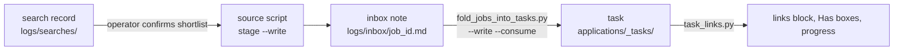
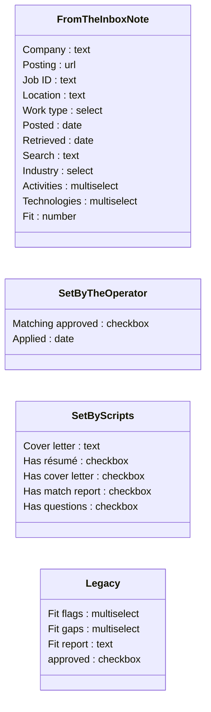
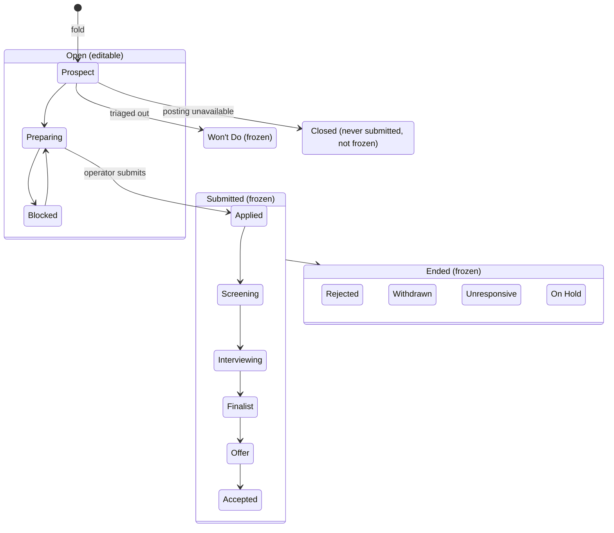

# Job Posting

A posting exists in two forms. A source script stages it as an **inbox note**; the fold turns that note into a **task** in the dotpm project, which is the only record of the posting from then on ([D5](../../context/decisions.md)).



## Identity

**`job_id` is the natural key** across both forms, the search records and the package. Its form tells the source (`naming.JOB_ID`):

| Source                | Form                               | Example            |
| --------------------- | ---------------------------------- | ------------------ |
| LinkedIn              | numeric, 10 digits                 | `4481619576`       |
| UI/UX Jobs Board      | numeric, 7 digits                  | `1649626`          |
| Jobgether             | 24-character hex                   |                    |
| Indeed                | 16-character hex (`jk`)            |                    |
| Fantastic.jobs        | `fj` + ATS id, or the LinkedIn id  | `fj1234567`        |
| TheirStack            | `ts` + id, or the LinkedIn or Indeed id | `ts1234567`   |

## Inbox note

`logs/inbox/<job_id>.md`, written by the source's `stage --write` (or by the `job-fetcher` for Chrome sources) and deleted by the fold's `--consume`.

| Key             | Required | Value                                                                 |
| --------------- | -------- | --------------------------------------------------------------------- |
| `type`          | yes      | `linkedin-job`, `fantastic-job`, …: the source                        |
| `job_id`        | yes      | see Identity                                                          |
| `url`           | yes      | the posting's page                                                    |
| `title`         | yes      | the job title as the source gives it                                  |
| `company`       | yes      | the employer                                                          |
| `location`      | no       | as the source gives it                                                |
| `work_type`     | no       | `remote`, `hybrid` or `onsite`                                        |
| `retrieved_at`  | yes      | ISO timestamp of the fetch                                            |
| `posted`        | no       | ISO date the source posted it                                         |
| `posted_raw`    | no       | LinkedIn only: the age text it was derived from                       |
| `source_search` | yes      | the search name; Jobgether searches start `jg-`                       |
| `over100`       | no       | LinkedIn only: `true` when the header said 'Over 100 applicants'      |

The body is `# <title> — <company>`, then the description **verbatim as the source returned it**. Scripts cut it mechanically; nothing invents structure, fields or values.

## Task

One dotpm task per posting in `applications/_tasks/`. dotpm renames each file to a slug of its title (cut at 60 characters), so scripts find a task by its _Job ID_ field (`naming.find_task`), never by file name.

### Frontmatter

dotpm's own keys, as the fold writes them for a new task:

| Key           | Value                                                                                     |
| ------------- | ----------------------------------------------------------------------------------------- |
| `pm-task`     | `true`                                                                                    |
| `projectId`   | `"[[applications/DEFAULT\|Application Tracking]]"`                                        |
| `id`          | 16 random lowercase letters and digits                                                    |
| `title`       | `<Company> - <Job title>`; on a slug collision `<Company> (<job_id>) - <Job title>` ([D8](../../context/decisions.md)) |
| `type`        | `task`                                                                                    |
| `status`      | a status id (below); new tasks start at Prospect (`todo`)                                 |
| `priority`    | `critical`, or `medium` when the note had `over100` ([D27](../../context/decisions.md)). Kept on re-fold |
| `due`         | the retrieved date                                                                        |
| `progress`    | 0, 25, 50, 75 or 100, set by `task_links.py` ([D38](../../context/decisions.md))          |
| `createdAt`, `updatedAt` | ISO timestamps                                                                 |
| `customFields`| the posting's metadata, keyed by opaque field id                                          |

Also present, managed by dotpm: `parentId`, `start`, `completed`, `assignees`, `tags`, `subtaskIds`, `dependencies`.

### Custom fields

Values are keyed by **opaque field id**. Resolve ids by name with `python3 pipeline/scripts/naming.py ids`; never hard-code one or read the project note for it. Renaming a field is safe; deleting and recreating one orphans its values.



- **From the inbox note:** the fold maps note keys to fields (`company` → Company, `url` → Posting, `retrieved_at` → Retrieved, `source_search` → Search, `fit_score` → Fit, …) and creates a field that's missing. Re-folding updates these and keeps every other field.
- **Set by the operator:** _Matching approved_ is the render gate for the résumé; agents never check it ([D22](../../context/decisions.md)).
- **Set by scripts:** `render_cover_letter.py` sets _Cover letter_ to a wikilink to the letter's `.docx`. `task_links.py` sets the four _Has_ boxes from the files on disk.
- **Legacy:** written by the retired Fit batches ([D6](../../context/decisions.md), [D34](../../context/decisions.md)) and kept on old tasks. _Résumé variant_ is retired ([D36](../../context/decisions.md)).

### Statuses

`status` holds an id; scripts resolve it **by label** from the project note's `config.statuses`. The "done" toggle (`complete: true`) freezes a posting's package ([D13](../../context/decisions.md)). Never change a posting's status unless the operator asks.

| Label        | id              | Done (frozen) |
| ------------ | --------------- | ------------- |
| Prospect     | `todo`          |               |
| Preparing    | `in-progress`   |               |
| Blocked      | `status-8fsgwr` |               |
| Applied      | `blocked`       | ✓             |
| Screening    | `review`        | ✓ (also in code) |
| Interviewing | `done`          | ✓             |
| Finalist     | `cancelled`     | ✓             |
| Offer        | `status-2von90` | ✓             |
| Accepted     | `status-qijrhi` | ✓             |
| Rejected     | `status-085k92` | ✓             |
| Withdrawn    | `status-xgl78t` | ✓             |
| Unresponsive | `status-0kozmp` | ✓             |
| On Hold      | `status-ci1ckj` | ✓             |
| Won't Do     | `status-s62o7t` | ✓             |
| Closed       | `status-5ci3xo` |               |

Ids don't match labels (the id `blocked` is labelled Applied), which is why nothing resolves a status by id. The usual path:



### Body

```markdown
# <Job title> — <Company>

<!-- links -->
- **Posting:** [<job title>](<url>)
- **Résumé:** [[<path to .docx>|<file name>]] · [[<path to .pdf>|PDF]]     or: no resume
- **Cover letter:** [[<path to letter .docx>|<file name>]]                or: no cover letter
- **Interest statement:** [[<path>/why-interested.md|why-interested]]      only when the file exists
- **Match report:** [[<path>/match-report.md|Match report]]               only when the file exists
<!-- /links -->

<the description, verbatim from the inbox note>
```

`task_links.py` owns the links block and rebuilds it from the files in the posting's [Application](Application.md) folder on every run; the fold, both renderers and the package skills call it. Never edit the block by hand.
