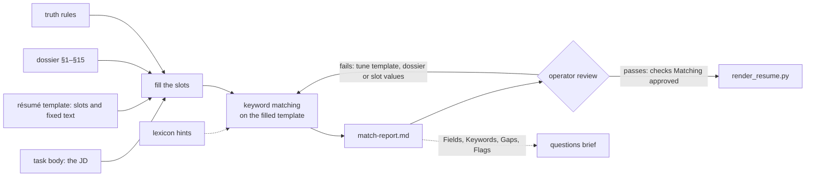
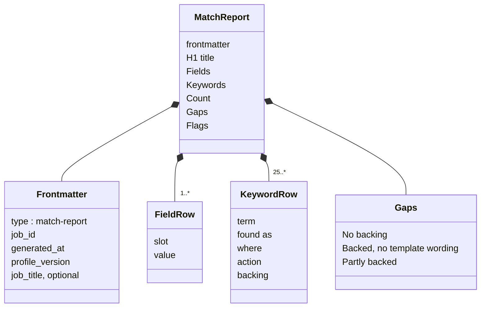
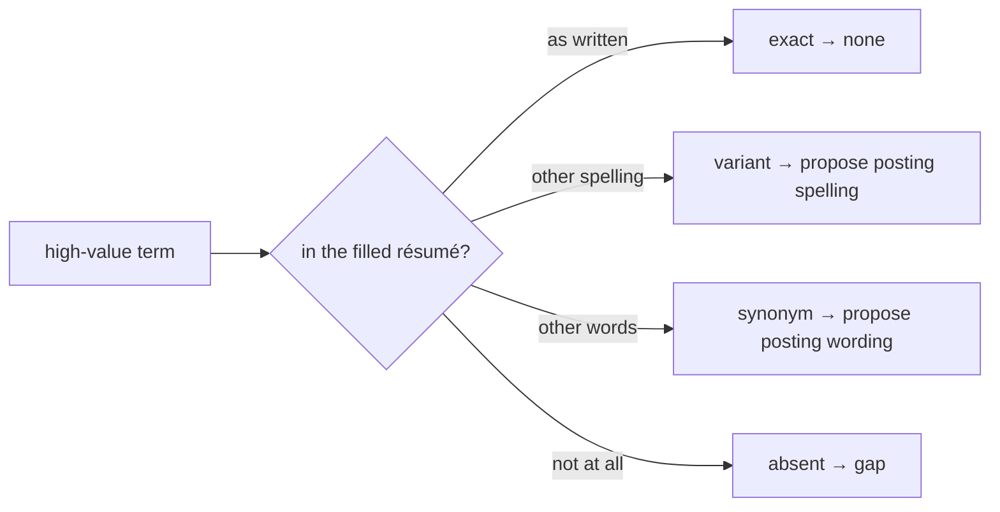

# Match Report

`applications/<task name>/match-report.md`, written by [`/resume-tailoring`](../../pipeline/skills/resume-tailoring/SKILL.md) (steps 2–3, on Opus) and the single review stop before the résumé renders ([D20](../../context/decisions.md)). The skill is the operational authority; this model is the shape it writes.

## Why

Applicant tracking systems rank applications by how well their wording matches the posting, so they decide whether a person ever reads one. The report makes the planned wording visible: which terms the résumé already carries, which it could carry with a swap, and which the candidate can't honestly claim. The operator tunes or approves before render.

## Role in the package

`render_resume.py` reads the Fields table to fill the template. The questions brief reads its present rows as evidence and its absent rows and flags as terms to avoid. Approval lives on the task (_Matching approved_), not in the report ([D22](../../context/decisions.md)).

## Structure

### Frontmatter

| Key               | Value                                                                    |
| ----------------- | ------------------------------------------------------------------------ |
| `type`            | `match-report`                                                           |
| `job_id`          | the posting's id, quoted                                                 |
| `generated_at`    | ISO date                                                                 |
| `profile_version` | the dossier's `updated:` date                                            |
| `job_title`       | optional: the cleaned title `render_resume.py` will fill                 |

No `status` key: a `status` in older reports is ignored.

### Title

`# Match report: <task name>`

### Fields

One row per slot in the résumé template's `slots:` block, `| slot | value |`, then the Summary sentence as it will read with the values in place. The table is the record of the slots: no Slot choices prose ([D29](../../context/decisions.md)). Add a line only where the operator must decide something the table can't show.

| Slot                | Filled by | Form                                                                  | Length    |
| ------------------- | --------- | --------------------------------------------------------------------- | --------- |
| `job_title_article` | script    | 'a' or 'an', whichever reads correctly before `job_title`             |           |
| `job_title`         | script    | the posting's title without the company (`naming.job_title()`)        |           |
| `role_summary`      | agent     | verb phrase completing 'who will …'; base-form verb, no closing period | 6–15 words |
| `hook_quality`      | agent     | noun phrase completing 'Given …': one quality of the posting          | 3–10 words |
| `related_projects`  | agent     | 2–3 of the template's `options`, exactly as written, joined as one phrase ('A, B and C') | |
| `common_theme`      | agent     | noun phrase completing 'with its focus on …'; true of every chosen project | 2–6 words |

The résumé template defines the slots and their options; this table follows the template, and a template change changes it. The script-filled values are recorded for reading and never hand-edited. No value contains `< > { } "` or curly quotes ([D9](../../context/decisions.md)).

### Keywords

Produced by the [keyword-matching spec](../../pipeline/specs/keyword-matching-spec.md), run on the template **after** the slots are filled. One row per high-value term in the posting:

| Column     | Value                                                                                              |
| ---------- | -------------------------------------------------------------------------------------------------- |
| `term`     | the term as the posting writes it                                                                  |
| `found as` | `exact`, `variant` (spelling), `synonym`, or `absent`                                              |
| `where`    | the template section and its wording, quoted; marked as slot-only when found only in a slot; blank when absent |
| `action`   | `none` for exact; `template wording → posting wording` for variant and synonym; `gap` for absent   |
| `backing`  | the dossier section that supports the term (`§5`); blank when none                                 |

Actions are **proposals**. The skill never applies them to the template or to `resume.md`; the operator tunes the template's fixed text (the tune loop). A swap to fixed text applies to every later résumé.

Lexicon hints (`match_packet.py report --lexicon`) offer verdicts earlier reports reached for terms in this JD. They inform a row; they never add one ([D28](../../context/decisions.md)).

### Count

After the table: `**Count:** <present> of <rows> high-value terms present once actions are applied (target 25-35).` A count under 25 is recorded as a shortfall in the Gaps.

### Gaps

Bullets only, one short line each, no paragraphs, grouped:

- **No backing:** absent terms the dossier doesn't support. Never written into a slot, a swap, a letter or an answer.
- **Backed, no template wording:** the dossier supports the term but the template doesn't say it (with the § reference). Candidates for the operator's template tuning.
- **Partly backed:** what the dossier supports and what it doesn't.
- **Shortfall:** when the count is under 25.

### Flags

The eligibility facts the operator needs before approving ([D28](../../context/decisions.md)), as bullets, or `Flags: none`:

- a location the candidate's location and remote preference doesn't meet
- any stated pay range, quoted, not judged
- contract or staffing-firm terms, clearance, travel, required degrees, other pre-employment conditions

## Rules

- Every slot value and proposed swap traces to the dossier; the truth rules bind ([Honest tailoring](../../CLAUDE.md)).
- A posting term the dossier doesn't back is a gap, never a slot value or a swap.
- Once written, the skill runs `task_links.py --write <job_id>` so the task's _Has match report_ box and progress update ([D38](../../context/decisions.md)).
- A frozen posting's report is never rewritten ([D13](../../context/decisions.md)).
