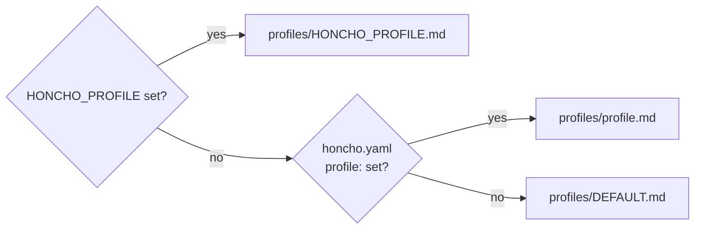
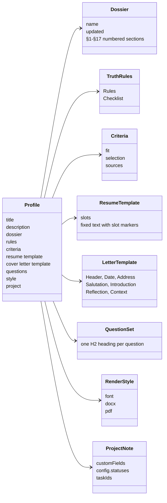

# Profile

A run profile is a markdown note in `profiles/` whose frontmatter names one file per input kind under `applicant/`. `naming.py` resolves every path from it ([D32](../../context/decisions.md)); `python3 pipeline/scripts/naming.py paths` prints the result. Skills and agents name an input by its role (the dossier, the truth rules), never by a hard-coded file.

## Selecting the profile

`honcho.yaml` is gitignored: it belongs to the install. `HONCHO_PROFILE` overrides it for one run.

## Frontmatter

| Key                     | Required | Resolves to                                | Input role                                                   |
| ----------------------- | -------- | ------------------------------------------ | ------------------------------------------------------------ |
| `title`                 | yes      |                                            | display name                                                 |
| `description`           | yes      |                                            | what the profile is for                                      |
| `dossier`               | no       | `applicant/dossiers/<value>.md`            | the only source of facts about the candidate                 |
| `rules`                 | no       | `applicant/rules/<value>.md`               | the binding truth rules                                      |
| `criteria`              | no       | `applicant/criteria/<value>.yaml` (or `.yaml.md`) | fit, selection, and one block per source ([D35](../../context/decisions.md)) |
| `resume template`       | no       | `applicant/resumes/<value>.md`             | fixed résumé text with `{{ slot }}` markers                  |
| `cover letter template` | no       | `applicant/cover letters/<value>.md`       | the letter's structure, header and fixed text                |
| `questions`             | no       | `applicant/questions/<value>.md`           | the question set for [Questions](Questions.md)               |
| `style`                 | no       | `applicant/styles/<value>.yaml`            | fonts, sizes and margins for `.docx` and `.pdf`              |
| `project`               | no       | `applications/<value>.md`                  | the dotpm project note that tracks the postings              |
| `author`                | no       |                                            | who maintains the profile (`candidate`)                      |
| `audience`              | no       |                                            | who reads it (`agents`)                                      |

**Matching.** A value matches a file stem case-insensitively, so `dossier: default` finds `DEFAULT.md`. A missing key means `default`. A value with no matching file resolves to a path that doesn't exist, and `naming.py paths` and `setup_check.py` report it as `missing`.

## What a profile points at

- **Dossier:** its `name:` is the candidate's name in every file name and sign-off (`naming.candidate_name()`). Skills cite it by section number (§10, §14), so the numbered `## N.` headings must stay as they are. Its `updated:` date is recorded as `profile_version` in every match report, résumé and letter.
- **Truth rules:** binding on every slot value, swap, letter and answer. If they and the dossier disagree, the dossier wins.
- **Résumé template:** see [Resume](Resume.md) and the slots in [Match Report](Match%20Report.md).

## Shipped defaults and personal files

The repo ships a generic `DEFAULT` file for every input kind, with `<placeholder>` text ([D33](../../context/decisions.md)). An install copies each to `<profile>.*`, points its profile there, and keeps those files gitignored. A placeholder left in a résumé or letter stops the render, because the renderers refuse `< >` ([D9](../../context/decisions.md)).
