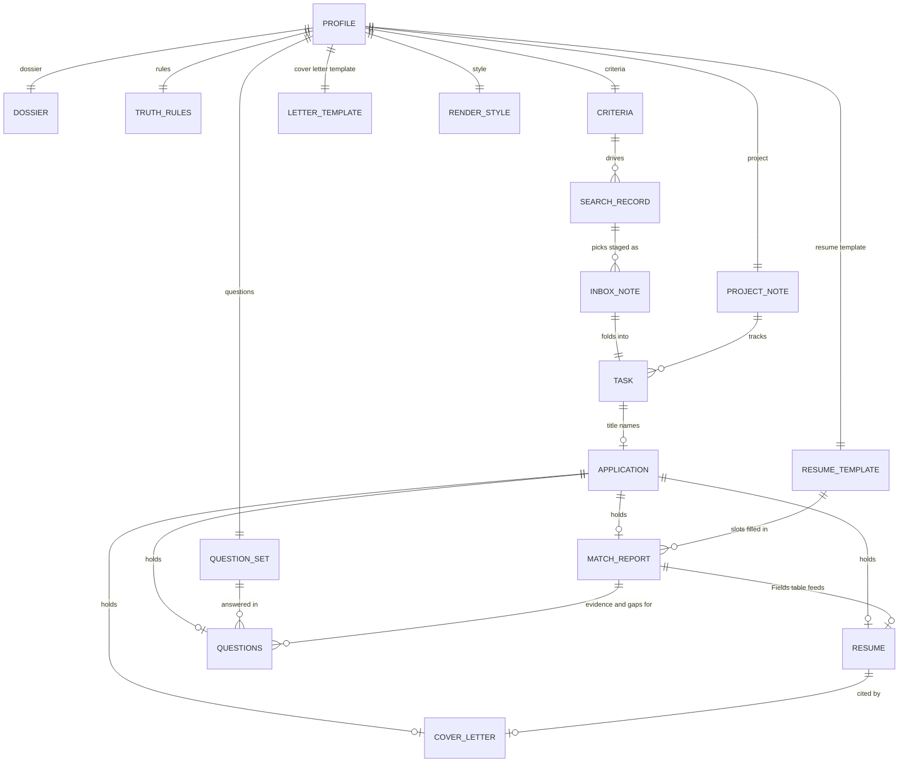
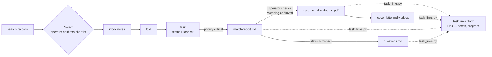

# Content models

Contracts for the structure of the objects the pipeline reads and writes. Each model says where the object lives, who writes it, and what it holds. The skills and scripts are the operational authority: when a model and its owner disagree, the owner wins and the model is fixed.

| Model                            | What it is                                                     | Lives at                                                     | Written by                                     |
| -------------------------------- | -------------------------------------------------------------- | ------------------------------------------------------------ | ---------------------------------------------- |
| [Profile](Profile.md)            | The run configuration: one input file per kind                 | `profiles/<profile>.md`                                      | the operator                                   |
| [Job Posting](Job%20Posting.md)  | One posting: a staged note, then a dotpm task                  | `logs/inbox/<job_id>.md`, then `applications/_tasks/`        | the source scripts, then the fold              |
| [Application](Application.md)    | The package folder for one posting                             | `applications/<task name>/`                                  | the package skills and the renderers           |
| [Match Report](Match%20Report.md) | Slot values and keyword matching, reviewed before render       | `applications/<task name>/match-report.md`                   | `/resume-tailoring`                            |
| [Resume](Resume.md)              | The filled résumé template and its rendered files              | `applications/<task name>/resume.md`, `.docx`, `.pdf`        | `render_resume.py`                             |
| [Cover Letter](Cover%20Letter.md) | The posting's letter and its rendered file                     | `applications/<task name>/cover-letter.md`, `.docx`          | `/cover-letter-writing`, `render_cover_letter.py` |
| [FAQs](FAQs.md)        | The question set, and one posting's answers to it              | `applicant/questions/`, `applications/<task name>/questions.md` | the operator, `/question-answers`              |

## How the models relate

The profile names every input. The criteria drive the searches, a search's picks are staged as inbox notes, and the fold turns each note into a task. The task's title names the package folder, which holds everything written for that posting.

## Flow and gates

Scripts do the mechanical steps; skills do the judgment steps. Each gate is a hard stop in code or in the skill.

- **Triage:** a new task is priority `critical`, or `medium` when LinkedIn showed over 100 applicants. Batch match reports go to critical Prospects only ([D27](../../context/decisions.md)).
- **Approval:** only the operator checks a task's _Matching approved_ box; `render_resume.py` refuses without it ([D22](../../context/decisions.md)).
- **Frozen:** nothing in a package is edited or re-rendered once its task is at Applied, Screening or any status with dotpm's "done" toggle ([D13](../../context/decisions.md)).
- **Form-safe text:** résumé, letter and answers never contain `< > { } "` or curly quotes; `charset.py` lints them ([D9](../../context/decisions.md)).

## Not modeled here

Run artifacts with no model yet: search records (`logs/searches/YYYY-MM-DD--<name>.md`), the titles index, the keyword lexicon (`logs/lexicon.json`), run logs and packets (`logs/runs/`). Their writers in [`pipeline/scripts/`](../../pipeline/scripts/README.md) define them.
