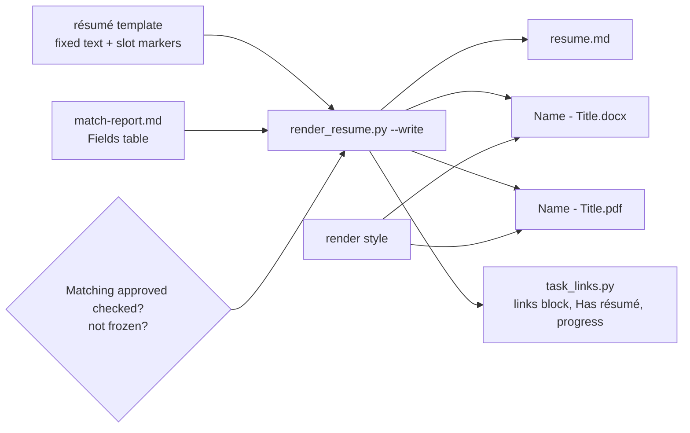
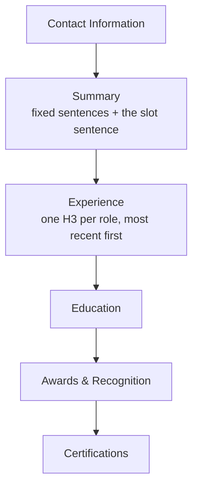

# Resume

A posting's résumé is the résumé template's fixed text plus a few bounded slots ([D18](../../context/decisions.md)). Tailoring fills the slots and writes no narrative; the [Match Report](Match%20Report.md) records the values and the operator approves them. `render_resume.py` does the rest.

## Files

| File                    | Role                                                       | Edited by          |
| ----------------------- | ---------------------------------------------------------- | ------------------ |
| `resume.md`             | the filled template with its metadata; the source of the two renders | the script only |
| `<Name> - <Title>.docx` | the submission file; the task's links block links it       | never by hand      |
| `<Name> - <Title>.pdf`  | the same résumé as a PDF                                   | never by hand      |

All three sit in the posting's [Application](Application.md) folder. Each render deletes and rewrites only the résumé's own files.

## resume.md

### Frontmatter

Written by `render_resume.py`:

| Key                 | Value                                                                    |
| ------------------- | ------------------------------------------------------------------------ |
| `type`              | `resume-posting`                                                         |
| `job_id`            | the posting's id (an integer when numeric)                               |
| `target_title`      | the job title without the company                                        |
| `company`           | the employer                                                             |
| `template`          | the résumé template's path, relative to the repo root                    |
| `match_report`      | `match-report.md`                                                        |
| `generated_at`      | ISO timestamp of the render                                              |
| `profile_version`   | the match report's `profile_version`                                     |
| `slots`             | each slot's value, from the report's Fields table                        |
| `target_vocabulary` | the report's present terms                                               |
| `gaps`              | the report's absent terms                                                |
| `render`            | `formats: [docx, pdf]`, `font`                                           |

### Body

The template's body with every `{{ slot }}` replaced. The section order comes from the template:

The slot sentence in the Summary reads:

> You are looking for `{{ job_title_article }} {{ job_title }}` who will `{{ role_summary }}`. Given `{{ hook_quality }}`, you will find `{{ related_projects }}` with their focus on `{{ common_theme }}` to be particularly interesting.

## Render rules

`render_resume.py` refuses when:

- the task's _Matching approved_ box is unchecked ([D22](../../context/decisions.md))
- the posting is frozen ([D13](../../context/decisions.md))
- a slot is unfilled (its braces remain)
- the text holds `< > { } "` or curly quotes ([D9](../../context/decisions.md)), which also catches a template placeholder left in place

Formatting follows the [ATS formatting spec](../../pipeline/specs/ats-formatting-spec.md) and the profile's render style: one standard font, body 10–12 pt, never shrunk to fit. There is no page limit ([D18](../../context/decisions.md)).

## Rules

- A tailored résumé changes emphasis and language, never facts. Only slot values change per posting; the fixed text changes only when the operator tunes the template.
- A frozen résumé can lag its template. That is intended: it records what was sent.
- A [Cover Letter](Cover%20Letter.md) cites this résumé's titles and numbers. If `resume.md` is regenerated after the letter, the letter is stale until re-checked.
